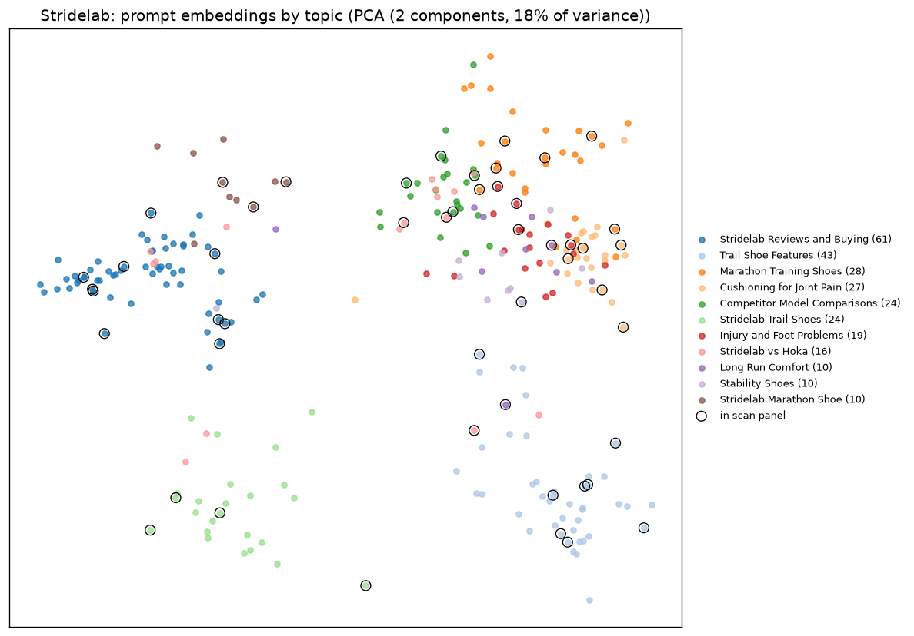

# Prompt panel: Stridelab

Category: **running shoes**. Personas: marathon beginner, trail runner, injury-prone runner.

- **272 prompts** after dedup (generated: 272); template versions: `panel/generate.v1` (272).
- **11 topics** (kmeans); labels from llm: 11.
- Intent labels by source: llm: 272. 18 prompts (7%) were labeled with a different intent than the generator was asked for.
- Scan panel: **50 prompts** covering 11/11 topics.
- Panel LLM calls in this DB: 39, estimated $0.0748 (all brands, since `llm_calls` has no brand id yet; mock calls are priced as if live).

## Topics

| Topic | Prompts | Share | In panel | Top intents | Most central prompts |
|---|---|---|---|---|---|
| Stridelab Reviews and Buying | 61 | 22% | 10 | nav 31, trans 19, comp 11 | stridelab reviews Is Stridelab legit? stridelab wide sizes |
| Trail Shoe Features | 43 | 16% | 8 | comm 18, info 15, trans 6 | what are lugs on trail shoes best trail running shoes for mud cheap trail running shoes |
| Marathon Training Shoes | 28 | 10% | 6 | comm 12, info 8, trans 4 | best running shoes for first marathon What shoes should a beginner buy for marathon training? Best running shoes for marathon training on concrete? |
| Cushioning for Joint Pain | 27 | 10% | 5 | info 11, comm 10, trans 5 | best running shoes for hip pain good running shoes for slow marathon runners What are the best running shoes for heavy runners with bad knees? |
| Competitor Model Comparisons | 24 | 9% | 4 | comp 11, trans 7, info 5 | brooks ghost vs asics novablast asics kayano or brooks adrenaline for overpronation Brooks Adrenaline vs ASICS Kayano for flat feet? |
| Stridelab Trail Shoes | 24 | 9% | 4 | nav 17, comp 4, trans 3 | buy stridelab trail shoes Is the Stridelab trail shoe good in snow? stridelab trail shoe drop |
| Injury and Foot Problems | 19 | 7% | 4 | comm 9, info 5, trans 5 | best shoes for shin splints cheap running shoes for shin splints buy running shoes for flat feet online |
| Stridelab vs Hoka | 16 | 6% | 3 | comp 14, trans 2 | stridelab trail vs hoka speedgoat Is Stridelab trail grip better than Hoka? Stridelab vs Hoka cushioning for heavy runners |
| Long Run Comfort | 10 | 4% | 2 | info 7, comm 2, nav 1 | best shoes for long runs? Do I need different shoes for long runs and easy runs? Should running shoes be a half size bigger for long runs? |
| Stability Shoes | 10 | 4% | 1 | info 4, comm 2, trans 2 | what is a stability shoe stability shoes deals cheap stability running shoes |
| Stridelab Marathon Shoe | 10 | 4% | 3 | comp 5, nav 4, trans 1 | buy stridelab marathon shoes does stridelab make a marathon shoe stridelab vs nike for marathon |

## Topic x intent

| Topic | informational | commercial | comparison | navigational | transactional |
|---|---|---|---|---|---|
| Stridelab Reviews and Buying | 0 | 0 | 11 | 31 | 19 |
| Trail Shoe Features | 15 | 18 | 4 | 0 | 6 |
| Marathon Training Shoes | 8 | 12 | 4 | 0 | 4 |
| Cushioning for Joint Pain | 11 | 10 | 0 | 1 | 5 |
| Competitor Model Comparisons | 5 | 1 | 11 | 0 | 7 |
| Stridelab Trail Shoes | 0 | 0 | 4 | 17 | 3 |
| Injury and Foot Problems | 5 | 9 | 0 | 0 | 5 |
| Stridelab vs Hoka | 0 | 0 | 14 | 0 | 2 |
| Long Run Comfort | 7 | 2 | 0 | 1 | 0 |
| Stability Shoes | 4 | 2 | 1 | 1 | 2 |
| Stridelab Marathon Shoe | 0 | 0 | 5 | 4 | 1 |
| **Total** | **55** | **54** | **54** | **55** | **54** |

## Funnel stage

awareness: 54, consideration: 159, decision: 59

## Map

Each dot is a prompt, coloured by topic and projected with PCA (2 components, 18% of variance). Circled dots are in the scan panel. Topics overlap in 2D because clustering ran on 20 PCA dimensions.

Generated by `scripts/panel_report.py`. In mock mode the prompts and labels are hand-authored fixtures and the embeddings are a deterministic hashing embedder, so this shows the pipeline, not real search demand.
