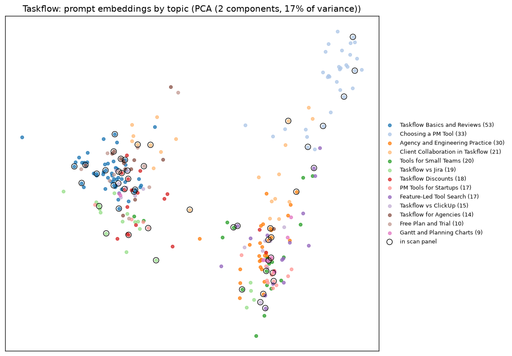

# Prompt panel: Taskflow

Category: **project management software**. Personas: startup founder, agency project manager, engineering lead.

- **276 prompts** after dedup (generated: 276); template versions: `panel/generate.v1` (276).
- **13 topics** (kmeans); labels from llm: 13.
- Intent labels by source: llm: 276. 22 prompts (8%) were labeled with a different intent than the generator was asked for.
- Scan panel: **50 prompts** covering 13/13 topics.
- Panel LLM calls in this DB: 42, estimated $0.0741 (all brands, since `llm_calls` has no brand id yet; mock calls are priced as if live).

## Topics

| Topic | Prompts | Share | In panel | Top intents | Most central prompts |
|---|---|---|---|---|---|
| Taskflow Basics and Reviews | 53 | 19% | 10 | nav 31, trans 17, comp 5 | What is Taskflow? taskflow login Is Taskflow legit? |
| Choosing a PM Tool | 33 | 12% | 5 | comm 21, info 7, trans 3 | best project management software with sso project management tool with a good api What's the best project management software for agencies? |
| Agency and Engineering Practice | 30 | 11% | 5 | info 20, comm 5, comp 3 | best software for agency resource planning Notion vs Jira for engineering docs and tickets? best software for managing freelancers and contractors |
| Client Collaboration in Taskflow | 21 | 8% | 4 | info 10, comp 4, nav 4 | task flow client approvals Is Taskflow better than Asana for client approvals? Can clients leave comments in Taskflow? |
| Tools for Small Teams | 20 | 7% | 4 | info 8, comm 7, comp 4 | best kanban app for small team Taskflow vs Notion for a small team? Best agile tool for remote engineering teams? |
| Taskflow vs Jira | 19 | 7% | 3 | comp 14, info 2, comm 1 | taskflow vs jira taskflow vs jira vs linear which is faster taskflow or jira |
| Taskflow Discounts | 18 | 7% | 4 | trans 11, nav 7 | taskflow education discount taskflow agency discount taskflow referral discount |
| PM Tools for Startups | 17 | 6% | 3 | info 5, comp 4, comm 3 | is taskflow good for startups asana vs clickup for startups TaskFlow PM reviews from startups |
| Feature-Led Tool Search | 17 | 6% | 3 | comm 14, info 2, trans 1 | best tool for tracking bugs and features together best pm tool with time tracking and invoicing best pm tool with slack integration |
| Taskflow vs ClickUp | 15 | 5% | 3 | comp 12, trans 3 | taskflow vs clickup pricing taskflow vs clickup for agencies taskflow vs clickup for agile |
| Taskflow for Agencies | 14 | 5% | 3 | comp 7, nav 5, trans 2 | taskflow vs asana for agencies taskflow vs asana taskflow deal for agencies |
| Free Plan and Trial | 10 | 4% | 2 | trans 6, nav 2, comp 2 | taskflow free trial taskflow vs trello Can I get a Taskflow free trial for my whole team? |
| Gantt and Planning Charts | 9 | 3% | 1 | info 4, nav 2, comm 1 | What is a Gantt chart used for? Does Taskflow have Gantt charts? cheapest gantt chart software |

## Topic x intent

| Topic | informational | commercial | comparison | navigational | transactional |
|---|---|---|---|---|---|
| Taskflow Basics and Reviews | 0 | 0 | 5 | 31 | 17 |
| Choosing a PM Tool | 7 | 21 | 2 | 0 | 3 |
| Agency and Engineering Practice | 20 | 5 | 3 | 0 | 2 |
| Client Collaboration in Taskflow | 10 | 2 | 4 | 4 | 1 |
| Tools for Small Teams | 8 | 7 | 4 | 0 | 1 |
| Taskflow vs Jira | 2 | 1 | 14 | 1 | 1 |
| Taskflow Discounts | 0 | 0 | 0 | 7 | 11 |
| PM Tools for Startups | 5 | 3 | 4 | 2 | 3 |
| Feature-Led Tool Search | 2 | 14 | 0 | 0 | 1 |
| Taskflow vs ClickUp | 0 | 0 | 12 | 0 | 3 |
| Taskflow for Agencies | 0 | 0 | 7 | 5 | 2 |
| Free Plan and Trial | 0 | 0 | 2 | 2 | 6 |
| Gantt and Planning Charts | 4 | 1 | 1 | 2 | 1 |
| **Total** | **58** | **54** | **58** | **54** | **52** |

## Funnel stage

awareness: 58, consideration: 162, decision: 56

## Map

Each dot is a prompt, coloured by topic and projected with PCA (2 components, 17% of variance). Circled dots are in the scan panel. Topics overlap in 2D because clustering ran on 20 PCA dimensions.

Generated by `scripts/panel_report.py`. In mock mode the prompts and labels are hand-authored fixtures and the embeddings are a deterministic hashing embedder, so this shows the pipeline, not real search demand.
